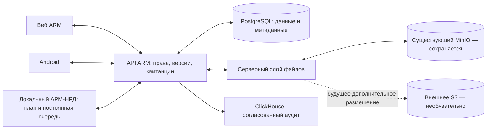

# Техническое задание: единый обмен ARM ↔ Android ↔ локальный АРМ-НРД

Дата: 10.11.2026. Статус: требования к реализации и выпуску; не акт готовности и не подтверждение развёртывания.

## 1. Цель и границы

Объединить веб-приложение ARM, мобильное приложение Android и локальную программу учёта работы локомотивных бригад в согласованный рабочий контур: заявки сотрудников → планирование → утверждение наряда → персональная выдача → обратные статусы → контроль выполнения и учёт. Локальная программа сохраняет возможность работать без сети; веб и Android получают согласованные серверные данные после восстановления связи.

Полномасштабная связь означает описание и реализацию всех перечисленных ниже потоков, а не только передачу TXT. Наличие API не означает наличия соответствующего экрана в каждом клиенте. Нереализованные экраны и методы учитываются как отдельные работы, а не объявляются готовыми.

Первый выпуск выполняется **на существующей инфраструктуре с существующим MinIO, без приобретения внешнего S3**. Само утверждение этого документа не разрешает выпуск незавершённых функций: обязательны этапы и приёмка из разделов 11–13.

## 2. Неизменяемые ограничения: MinIO сохраняется

1. **Не отключать, не заменять и не переносить существующий MinIO.** Не изменять его конфигурацию, бакеты, учётные данные, тома, сетевое размещение, политики доступа и действующие резервные копии в рамках этой задачи.
2. Не менять глобальные `AWS_BUCKET`, настройки существующего Laravel disk `s3`, текущие ключи объектов и пути старых документов. Не требовать нового бакета или нового хранилища для выпуска.
3. Новые файлы обмена размещать через серверный слой хранения в существующем приватном MinIO, в согласованном отдельном префиксе с уникальными ключами. Не перезаписывать старые объекты. Существующие загрузки Filament и выдачу документов не перестраивать мимоходом.
4. PostgreSQL — операционная база: пользователи, назначения, состояния, версии и права. MinIO — хранилище файлов. ClickHouse — аналитика. Это разные компоненты; внешнее S3 не заменяет ни PostgreSQL, ни MinIO.
5. Возможное внешнее S3 в будущем работает **совместно с MinIO** как дополнительное место хранения выбранных новых объектов или проверенных копий. Вывод MinIO из эксплуатации данным ТЗ запрещён.
6. Клиенты обращаются к ARM по HTTPS. Не передавать ключи MinIO/S3 в APK, Qt, браузер или файлы обмена. Новые файловые сценарии используют проверку прав ARM и FileProxyService; прямые ссылки на объектное хранилище не вводятся.
7. Сохранить действующие маршруты, роли, канонический дизайн карусели, старые документы и совместимость установленного APK. Не менять тарифы, формулы, нормативы и правила планирования в рамках интеграции.

## 3. Исходное состояние и известные ограничения

Исходная проверка охватывала Qt `arm-nrd` (`121a0a0`) и рабочий код ARM, включая `mobile`. В ходе подготовки данного ТЗ production не проверялся и не менялся.

| Контур | Найденная реализация | Что требуется завершить |
| --- | --- | --- |
| Подстройки машиниста | Android POST `/api/mobile/podstroiki`, очередь с operation_id | Полный цикл доставки, решения и отмены |
| Заявки инструктора на АТЗ | `/api/mobile/journal/training-requests`, проверки колонны и лимитов | Сверка отмен и возврат результата локального планирования |
| Получение заявок в Qt | GET `/api/mobile/podstroiki/sync-for-naryad?month=...`, ручной импорт F11 | Фоновый обмен, курсор, устойчивый inbox/outbox |
| Суточный наряд | DailyReportGenerator/DailyNaryadDialog создают TXT | Автоматическая передача утверждённого снимка и квитанция публикации |
| Серверная публикация | NaryadIssuePublisher и NaryadPersonFile, существующий MinIO | Безопасные редакции вместо удаления предыдущих файлов перед подготовкой |
| Выдача пользователям | Веб и мобильные GET `/api/mobile/naryads`, `/naryads/{id}` | Общая текущая редакция, обновление открытых экранов, расширенная приёмка прав |
| Остальные домены | В ARM и Qt существуют отдельные функции | Реестр контрактов, сопоставление идентификаторов и интеграция по разделу 4 |

Подтверждённый дефект: после удаления серверной карточки АТЗ текущий импортёр сохранял локальную карточку (`retained_local_cards=1`). Обратная квитанция применения заявки в просмотренном контуре отсутствует. Фоновая публикация TXT из Qt не реализована.

Риск по коду publisher: `deletePersonFiles()` вызывается до подготовки новой выдачи, результат `Storage::put()` не проверяется при `throw=false`. Отказ хранилища отдельно не воспроизводился; до автоматизации публикации этот риск необходимо устранить.

## 4. Полная матрица взаимодействий

Для каждого потока создать описание полей, прав, владельца записи, жизненного цикла, ошибок и тестов. Приведённые направления — целевые требования, а не перечень уже готовых API.

| Домен | Направление и результат | Владелец и ограничения |
| --- | --- | --- |
| Пользователи и доступ | ARM → Qt: разрешённая область работы и минимальные связи пользователей с персоналом; веб/Android используют серверный доступ | Роли и доступ определяет ARM. Локальный клиент не создаёт себе права |
| Картотека персонала | Сопоставление устойчивых ID сотрудников, табельных номеров, депо, колонн и периодов назначений | До записи определить владельца каждого поля между существующей картотекой ARM и Qt; спорное изменение — конфликт, а не молчаливая перезапись |
| НСИ и календарь | Версионные пакеты справочников, разбивок, праздников, норм и параметров для планирования | Единственный назначенный владелец каждого справочника; остальные клиенты читают. Исторический наряд сохраняет версию использованных справочников |
| Подстройки | Веб/Android → ARM → Qt; решение Qt → ARM → инициатор | Существующие серверные ограничения, периоды и права сохраняются; доставка удаления обязательна |
| Заявки АТЗ | Инструктор → ARM → Qt; решение и изменения расписания → ARM → инструктор/участники | Проверки колонны, состава участников и лимитов через существующие сервисы. Планирование не равно проведению занятия |
| Сетка и назначения | Qt ↔ ARM: утверждённые изменения плана, замены, версии месяца/дня | Один активный владелец редактирования области плана либо явный протокол конфликта. Веб-планирование и Qt не должны независимо затирать друг друга |
| Отвлечения и отсутствия | Обмен согласованными периодами отпуска, больничного, учёбы и других имеющихся типов | Личные записи сотрудника отделены от утверждённой кадровой/плановой записи. Подтверждение выполняет уполномоченный сотрудник; новые формулы оплаты не вводятся |
| Суточный наряд | Qt → ARM: утверждённый TXT и машинный manifest; ARM → веб/Android: общая и персональная выдача | Публикация только после проверок; машинист видит разрешённые ему данные, инструктор — свою колонну, нарядчик — свою область |
| Расшифровка смен | Разбивки и обозначения → единое представление наряда во всех клиентах | Использовать существующие калькуляторы часов и версионные справочники; не дублировать формулы в новых контроллерах |
| Часы: план и факт | План Qt → ARM; подтверждённый факт из уполномоченного контура → потребители | План, личный календарь WorkShift и официальный учёт — отдельные сущности. Публикация наряда не создаёт автоматически фактически отработанные часы |
| Официальный учёт | Согласованные данные между локальным учётом и существующим `/uchet`, отчёты и выгрузки | Не заводить параллельные таблицы вместо принятой схемы АРМ-ЛБ. Владельца факта и закрытого месяца фиксировать до реализации; изменение закрытого периода — отдельная процедура |
| Обучение и формуляр | ARM ведёт фактические результаты, задания, ознакомления и записи; Qt получает необходимые для работы разрешённые статусы | Не закрывать занятие, норматив, задачу или ознакомление по одному факту назначения в наряд |
| Задачи и документация | ARM → клиенты: разрешённые документы и задачи; действия пользователя → ARM | Серверные права и подтверждения сохраняются. Для Qt определить необходимый экран либо переход в ARM с обычной авторизацией; полное копирование библиотеки на ПК не требуется |
| Рабочий чат | Центральный чат ARM: участники, сообщения, вложения, статусы чтения; доступ из разрешённых клиентов | История и членство определяются ARM. Нативный Qt-интерфейс — отдельная работа; до него допустим явно обозначенный переход в веб, без заявления о готовом Qt-чате |
| Уведомления | Из подтверждённых серверных событий → веб/Android/локальный индикатор | Уведомление — сигнал перечитать состояние, не источник истины. Telegram не является обязательным транспортом обмена |
| Ошибки и сверка | Клиенты → ARM: квитанции и безопасная диагностика; ARM → клиент: состояние и инструкция исправления | Не передавать в диагностике токены, пароли, полные документы и персональные данные |

До начала реализации составить реестр существующих экранов и методов каждого клиента с отметками «готово», «доработка», «новая функция». Всё, что исключается из первого выпуска, явно перечислить в его паспорте; не называть ограниченный выпуск полной реализацией ТЗ. Будущие функции Qt из его roadmap, включая расширенный фактический учёт, не считать уже реализованными.

## 5. Идентификаторы, версии и контракт

- Назначить глобальные ID сущностей и таблицу соответствий локальным ID. ФИО не является ключом: необходимы тесты однофамильцев, сокращений, смены фамилии и несовпадающих табельных номеров. Неоднозначность блокирует персональную выдачу до сверки.
- Каждая изменяемая сущность имеет серверную версию; публикация — неизменяемую редакцию. Время устройства не определяет победителя конфликта.
- Команда содержит operation_id, тип операции, ID сущности, ожидаемую версию и неизменяемое тело. Область депо и права сервер проверяет по учётной записи, а не доверяет полям команды.
- Повтор operation_id с тем же содержимым возвращает прежний результат; с другим — конфликт. Зафиксировать каноническое представление для проверки хеша и срок хранения дедупликационных записей не короче разрешённого окна повторов.
- Получение изменений: ограниченные страницы, курсор, область, версия схемы, контроль полноты. Курсор продвигается после локальной фиксации страницы.
- Удаления/отмены доставлять tombstone-записями. Их срок хранения превышает допустимое время автономной работы. Просроченный курсор требует полной сверки с явно полным снимком; пустой или частичный ответ не означает удаление всех записей.
- ACK получения отдельно от делового результата. Деловые состояния: ожидает решения, применена в план, отклонена, отменена, требует сверки. Состояния доставки хранить отдельно.
- HTTP: 401 — восстановление авторизации; 403 — запрет; 409 — конфликт версии; 422 — ошибки содержимого; 429 — ограничение с задержкой; временные сетевые/серверные ошибки — безопасный повтор.
- Описать OpenAPI/JSON Schema, примеры и версионирование новых методов. Предлагаемый отдельный namespace обмена не считать существующим маршрутом. Старые мобильные методы сохраняются до согласованного обновления клиентов.
- Файловый/USB-обмен при необходимости использует те же ID, версии, операции и квитанции, а также проверяемое происхождение пакета. Контрольная сумма сама по себе не подтверждает отправителя. Файловый импорт не обходит авторизацию и правила плана.

## 6. Автономная работа и устойчивый фоновый обмен

1. В Qt создать постоянные inbox/outbox. Изменение локального назначения, результат заявки и задача ответа сохраняются одной локальной транзакцией. Распределённая транзакция между двумя PostgreSQL не требуется.
2. Утверждённый TXT сохранять неизменяемым снимком вместе с задачей либо по проверяемому протоколу атомарного файлового сохранения. Ссылка на изменяемый файл недостаточна.
3. Задача хранит ID, версию, точное тело/снимок, хеш, область, состояние, попытки, время повтора и безопасное описание ошибки. Токены не входят в тело очереди.
4. HTTP работает асинхронно, не блокирует сетку и не использует вложенный сетевой QEventLoop в обработчике кнопки. Запуск — при старте, периодически и при восстановлении доступности API.
5. Повторы с увеличением задержки и случайным разбросом; ограничить параллелизм, размер порций и таймауты. После неопределённого результата повторять ту же операцию, а не создавать новую.
6. После сбоя восстанавливать зависшие отправки; несколько экземпляров клиента используют захват задачи с ограниченной арендой. Серверная дедупликация обязательна независимо от захвата.
7. Порядок соблюдать внутри сущности/редакции, независимые задачи не блокировать. Отмена уже применённой заявки требует сверки связанных назначений, без удаления ручных изменений.
8. Показывать последнее успешное обновление, возраст данных, очередь и конфликты. Ошибка диска означает, что задача не сохранена; нельзя показывать успешную постановку.
9. Автоматический обмен работает, пока Qt запущен. После закрытия очередь сохраняется; отправка при закрытом приложении требует отдельно реализованной службы ОС.
10. Отзыв доступа блокирует дальнейший обмен. Нельзя обещать удаление уже полученных данных с недоступного автономного ПК; объём локальных персональных данных минимизировать.

## 7. Надёжная публикация на существующем MinIO

1. Нарядчик явно утверждает редакцию; предпросмотр или промежуточная правка не публикуют документ.
2. Qt передаёт по API TXT, manifest сопоставления сотрудников, дату, идентификатор области, хеш и ожидаемую редакцию. Для небольшого TXT прямая загрузка в MinIO не нужна.
3. Сервер проверяет полномочия, размер, кодировку, структуру, дату, справочники, неоднозначных сотрудников и версию. Состояние `processing` не равно публикации.
4. Оригинал и производные файлы записываются в новый префикс/редакцию существующего MinIO. Проверять результат каждой записи, размер и хеш; `put=false` является ошибкой.
5. Только после готовности всех обязательных объектов транзакция PostgreSQL переключает указатель текущей редакции. В той же транзакции создаётся запись outbox уведомлений. Старые файлы до этого не удаляются.
6. Объектное хранилище и PostgreSQL не имеют общей транзакции: нужны восстановление незавершённой обработки и безопасная уборка только новых неподключённых объектов по согласованной политике.
7. Запоздалая старая задача не может заменить более новую редакцию. Повтор загрузки или обработки не создаёт дубликаты.
8. Qt получает окончательную квитанцию `published` с ID, редакцией и хешем. При разрыве после принятия файла проверяет уже созданную операцию.
9. Веб/Android используют одну опубликованную редакцию; обновляют открытый экран по событию либо ограниченному опросу revision. Push и Telegram не обязательны для корректности.
10. Ошибка подготовки новой редакции сохраняет предыдущую ссылку и файлы. **Если сам MinIO недоступен, чтение лежащих в нём файлов также недоступно:** сохранение предыдущей редакции не является резервным хранилищем.

## 8. Будущее масштабирование: внешний S3 совместно с MinIO

Этот раздел — следующий необязательный этап, не зависимость первого выпуска.

- Ввести серверные метаданные размещения новых объектов: идентификатор backend, логический bucket reference, object_key, размер, SHA-256, редакция и статус проверки. Секреты — только в серверной конфигурации. Старые записи без этих полей разрешаются в существующий MinIO.
- Слой хранения выбирает размещение по метаданным. Он добавляется в пределах обмена нарядами; глобальную работу FileProxy/Filament/других документов не переписывать без отдельной проверки.
- Внешнее S3 подключается дополнительным disk/backend. MinIO остаётся действующим. Возможные режимы: новые выбранные объекты во внешнем хранилище; проверенные дополнительные копии; постепенное изменение основного места чтения отдельных объектов.
- Перенос выбранного объекта: копирование → проверка размера и хеша → фиксация готовности → атомарное изменение метаданных чтения. Исходный объект MinIO сохраняется. Ошибка копирования не меняет рабочую ссылку.
- API, ID нарядов и сценарии клиентов остаются прежними; обновление APK/Qt из-за смены backend не требуется. Файлы выдаются через ARM с прежней авторизацией.
- Резервное чтение допускается только с проверенной копии того же содержимого. Если копии нет, возвращается честная ошибка; нельзя выдавать другую редакцию незаметно.
- Согласование копий выполнять устойчивыми заданиями; не считать две записи в разных хранилищах атомарными. Проверять повтор, рассинхронизацию, отказ внешнего S3 и возврат чтения в MinIO.
- Бюджет, трафик, юрисдикция персональных данных и политика хранения согласуются перед подключением. Новые lifecycle-правила и удаление существующих объектов не входят в этот этап.

«Бесшовно» означает неизменный клиентский контракт и управляемое переключение проверенных объектов, а не отсутствие работ по настройке, проверке и резервированию. Внешнее S3 не устраняет нагрузку на расчёты, PostgreSQL и PHP само по себе.

## 9. Безопасность и сохранность

- Использовать существующие роли и серверные проверки: dispatcher для планирования, instructor для разрешённой колонны, driver для личных данных, operator для официального учёта, административные права — по принятой модели. Не вводить новую роль ради desktop-клиента.
- Desktop получает отдельные отзываемые ограниченные учётные данные, а не общий административный токен. Ограничения устройства, области, срока действия и хранения учётных данных описать в контракте; изменения существующих барьеров не выполнять попутно.
- Проверять права на каждую сущность и файл, включая запрос по известному чужому ID. Не доверять присланным user_id, column_id, depot_id и пути объекта.
- Валидировать загрузки, исключить traversal и неограниченное потребление памяти; установить лимиты тела, частоты и числа фоновых задач. Не исполнять содержимое TXT/manifest.
- Не включать ФИО, телефоны, токены и полные тексты документов в диагностические журналы. Значимые действия логировать существующим ClickHouseService через очередь; новые типы событий вынести на отдельное согласование до внедрения.
- Защита HTTPS, приватной сети и прав доступа не равнозначна шифрованию персональных полей. Шифрование идентифицирующих данных с отдельным управлением ключами/привязанными устройствами — ранее намеченный самостоятельный этап, не объявлять его реализованным этим обменом.
- До миграций создать согласованную копию БД и связанных объектов и проверить восстановление в изолированной среде. Учитывать доступное резервирование на ПК; не считать копию на том же сервере независимой.
- Срок хранения событий ClickHouse и срок хранения эксплуатационных документов различаются. Возможный архив на 45 лет требует отдельного бюджета, правил, резервирования и проверки восстановления; данное ТЗ не обещает такое хранение автоматически.

## 10. Нагрузка и наблюдаемость

Не обещать 500 одновременно работающих пользователей на основании этой интеграции. Предыдущие замеры и их ограничения приведены в `docs/operations/capacity/2026-11-09/READINESS_500.md` репозитория ARM; они не заменяют испытания нового обмена.

Собирать безопасные метрики: возраст очереди, число задач/конфликтов, задержку доставки и публикации, долю ошибок, доступность API/MinIO, нагрузку CPU/RAM, PostgreSQL, PHP-FPM и фоновых работников. Не превращать метрики в хранилище персональных данных.

Использовать порции изменений, курсоры, контроль revision, разброс периодов опроса и ограничение параллельности. Фоновый обмен не должен создавать волну полных загрузок при одновременном запуске ПК. Численные интервалы, бюджеты времени ответа и допускаемую нагрузку утвердить по измерениям на согласованном профиле, а не выдавать предположения за результат тестирования.

## 11. Этапы реализации и контроль

- [ ] **Этап 1 — инвентаризация и контракты.** Реестр всех потоков раздела 4, источники истины по полям, владельцы справочников, схема идентификаторов, права, версии, окно автономности, OpenAPI, совместимость установленных клиентов. Закрыть неоднозначности до записи в рабочие данные.
- [ ] **Этап 2 — заявки и квитанции.** Устранить сохранение отменённых АТЗ; реализовать версии/отмены, результаты применения, конфликты и повтор. Проверить отдельно на копии локальной рабочей БД.
- [ ] **Этап 3 — фоновый контур Qt.** Постоянные inbox/outbox, асинхронность, восстановление после сбоя, индикатор, безопасная авторизация, ограниченный опрос.
- [ ] **Этап 4 — публикация нарядов.** API приёма TXT/manifest, неизменяемые редакции, проверка записей в существующий MinIO, атомарное переключение и уведомления. Не менять конфигурацию MinIO.
- [ ] **Этап 5 — единая выдача.** Личный наряд, инструкторская колонна, расшифровка смен, обновления веба/Android, совместимость старого APK, квитанции Qt.
- [ ] **Этап 6 — остальные взаимодействия.** Персонал, справочники, назначения, отвлечения, план/факт и учёт, обучение, задачи, документы, чат по утверждённой матрице. Незавершённые функции явно остаются в плане; готовые интегрируются без подмены владельца данных.
- [ ] **Этап 7 — сквозная приёмка и выпуск на текущей инфраструктуре.** Изолированный стенд с MinIO, установленный APK, сборка Qt, совместимость и откат; затем ограниченный production-выпуск и контроль метрик.
- [ ] **Следующий необязательный этап — внешнее S3.** Только после отдельного решения о масштабировании; совместная работа с сохранённым MinIO по разделу 8.

Первый ограниченный выпуск может включать этапы 1–5 при отдельном утверждении его паспорта. Полная реализация данного ТЗ требует также закрытия матрицы этапа 6. Реализация финансовых функций, которых ещё нет в Qt, требует отдельной спецификации и согласования правил.

## 12. Приёмочные сценарии

| Проверка | Обязательный результат |
| --- | --- |
| Заявка Android/веб → ARM → Qt → решение → ARM → инициатор | Совпадающие ID, версии и статусы; нет ручного изменения БД |
| Удаление АТЗ до/после применения | Отмена доставлена; применённое назначение сверяется, ручные правки не теряются |
| Потеря сети, перезапуск Qt, восстановление | Задачи и точные снимки сохранены, обмен возобновляется без F11 |
| Обрыв после принятия сервером | Повтор возвращает прежний результат без второй операции/редакции |
| Два редактора, устаревшая заявка, переставленные редакции | Явный конфликт; более старые данные не затирают новые |
| Частичный/пустой ответ, просроченный курсор | Нет массового ложного удаления; выполняется контролируемая полная сверка |
| Ошибка парсинга или записи нового объекта | Предыдущая редакция и файлы не удалены; новая не помечена опубликованной |
| Недоступен MinIO | Локальная работа продолжается; сервер честно сообщает недоступность файлов, не подтверждает публикацию |
| Однофамильцы, смена ФИО, неизвестный сотрудник | Нет выдачи чужого личного наряда; неоднозначность требует сверки |
| Чужой пользователь/колонна/депо/файл, отозванный токен | Доступ запрещён всеми клиентами, включая прямой запрос API |
| Изменение НСИ, закрытый месяц, план против факта | История сохраняется; финансовые данные не пересчитываются неявно |
| Задачи, обучение, документы и чат | Права, подтверждения и версии проходят тесты согласно реестру потоков |
| Старый APK и старые документы | Существующие функции, маршруты, загрузки и просмотр работают |
| Нет внешнего S3 | Весь согласованный первый выпуск работает с существующим MinIO |
| Восстановление резервной копии и откат версии | Восстановлены согласованные записи и объекты; очереди не порождают дубликаты |
| Будущий перенос выбранных объектов | API не меняется, хеши совпадают, исходные объекты MinIO сохранены |

Отказные тесты проводить в изолированной среде, не отключая production MinIO. После правок доступа/файлов/маршрутов выполнить существующие JournalAccessTest, FileProxyTest, NaryadPlanningTest, WebRoutesSplitTest, UserRoleAccessTest и профильные тесты обмена/публикации; добавить необходимые контрактные, Qt и мобильные проверки.

## 13. Условия выпуска в production

1. Зафиксированы состав выпуска, версии сервера/APK/Qt, ограничения и результаты приёмки. Наличие документа или успешного импорта одного JSON недостаточно.
2. Миграции добавочные и совместимые с предыдущими клиентами; согласованы с существующей схемой АРМ-ЛБ. Изменения выполняются штатным deploy-процессом, без постоянного расширения runtime-прав БД/файловой системы.
3. Проверены резервное восстановление, схема отката приложения и совместимость схемы данных после отката. Уже опубликованные редакции не теряются.
4. Конфигурация и данные MinIO остаются неизменными; новые объекты обмена не затрагивают прежние ключи. Контроль до/после подтверждает старые документы и права.
5. На первой группе уполномоченных пользователей пройден реальный цикл APK → ARM → Qt → публикация → веб/APK. Проверены права всех затронутых ролей.
6. Контролируются очереди, ошибки, задержки и ресурсы. При нарушении порогов приостановить новый обмен управляемым переключателем, сохранив старую выдачу и накопленные задачи; не отключать весь ресурс.
7. Расширение доступа — после стабильного наблюдения и нагрузочного теста согласованного профиля. Текущий выпуск не зависит от внешнего S3.

## 14. Результаты работ

Передать: реестр потоков и экранов; согласованную схему владельцев/идентификаторов; OpenAPI и примеры; миграции; серверный и Qt-код; обновлённый APK при изменении клиента; автоматические тесты и сквозной протокол; инструкцию настройки без секретов; правила разрешения конфликтов; runbook развёртывания, восстановления и отката; список оставшихся ограничений.

## Приложение. Основания и историческая проверка

Прочитанные источники: серверные маршруты, контроллеры заявок/нарядов, NaryadIssuePublisher, конфигурация файлового хранения, TwoSideApi.md, armd-progress.md; Qt NaryadSyncClient, DailyReportGenerator и OPERATIONAL_ROADMAP.md. Текущая версия ТЗ заменяет прежнюю рекомендацию обязательного отдельного S3-бакета: **такого требования больше нет**.

Результаты из исходного обзора сохранены как исторические, в рамках редактирования документа заново не запускались:

- 22 серверных теста заявок/карточек/исправлений: 158 assertions.
- 4 теста публикации/веб-доступа: 26 assertions, файловое хранилище заменено Storage::fake.
- 9 Node-тестов очередей подстроек/АТЗ.
- Дополнительный контрактный тест: 11 assertions; C++-импорт ответа тестового API: `success=1, individual=1, cards=1`.
- После серверного удаления карточки: `import_success=1, retained_local_cards=1` — воспроизведённый незакрытый дефект исходного обзора.

Эти результаты не подтверждают полевой цикл production, работу реального хранилища или готовность всего ТЗ. Исправления последовательности версий рассматриваются отдельно: [отчёт 1a6198c](ARM_NRD_PRODUCTION_VERIFY_1a6198c_2026-11-10.md). Они не заменяют реализацию обратных квитанций и публикации.

[Материалы исходной проверки](reviews/arm-exchange-2026-11-10/), [контрактный тест](reviews/arm-exchange-2026-11-10/server/ExchangeContractReviewTest.php), [импорт и удаление карточки](reviews/arm-exchange-2026-11-10/desktop/import-contract.log).
